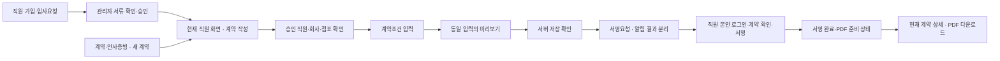

# [AADS/오비서] 현재 관리자 직원 계약 통합 — 화면·API 설계 v1.0.1 (검토 초안)

버전: 1.0.1 / 검토용 초안 / AADS-LAYOUT-023_obys-admin-contract-plan.md와 AADS-LAYOUT-025_obys-admin-contract-prd.md 기준

## 정보 구조와 화면

현재 관리자 진입 파일 `app/static/apps/obys/mockup-v4-1.html`을 유지한다. 사용자에게 표시할 이름은 직원·급여 → 직원 현황, 계약·인사증빙이다. 아래 URL 파라미터는 **구현 제안**이며 현재 동작을 보장하지 않는다.

| 화면 | 제안 진입/상태 | 구성과 행동 |
|---|---|---|
| 직원 현황 | 기존 `employees` 화면 | 승인 여부·회사·점포·계약 상태, 승인 직원에 계약 작성 |
| 계약 작성 패널 | `?route=hr-docs&employee_request_id=...` | 직원/사업자/점포 고정 문맥, 조건 입력→미리보기→저장 |
| 계약 상세 | `?route=hr-docs&contract_id=...` | 저장 조건, 상태·최근 오류, 서명요청·재알림·PDF |
| 직원 서명 | 기존 signing token 경로 | 로그인 복구 후 본인 계약 확인·동의·자필서명 |

URL에 이름·전화·급여·서명 토큰을 추가로 기록하지 않는다. `route` 파라미터 지원 여부는 구현 작업에서 기존 라우터와 맞춰 확정한다. 화면 이동보다 단일 패널을 우선하되 새로고침·뒤로가기 복구를 지원한다.

## 계약 편집기

단계 1 대상 확인: 승인 직원 연결을 서버에서 조회하고 회사·점포를 명시한다. 미승인 대상, 접근 불가 대상에는 작성 버튼을 비활성화하고 필요한 다음 행동을 표시한다.

단계 2 조건 입력: 가입/사업자 마스터의 기존 데이터로 본인·사용자 기본정보를 채우고 누락 항목을 표시한다. 관리자는 계약 유형, 계약 작성일, 입사일·계약기간, 직무·근무 장소, 임금 산정 방식·금액·지급일, 요일별 근무/휴게·주간시간, 수당·보험·수습·기타 조항을 검토한다. 유형별 필수 필드는 서비스 validator를 따른다. 일정이 점포마다 다르면 별도 행으로 명확히 입력하며 서로 다른 사용자 사업자의 조건은 하나로 합치지 않는다.

단계 3 미리보기: 입력 스냅샷과 원본 템플릿 버전을 연결한다. 미리보기에서 돌아와 수정하면 이전 미리보기는 무효화된다. 서버 저장 성공 전에는 서명요청을 허용하지 않는다.

단계 4 요청·관리: 저장 결과의 계약 ID를 기준으로 요청한다. 요청됨·알림 실패·PDF 생성 실패를 같은 성공 표시로 묶지 않는다. 링크 복사는 실제 요청 응답 링크가 있을 때만 제공하며 이메일/SMS 전달 완료와 구분한다.

## 기존 API 연결

base는 `app/api/obys_finance.py`의 router prefix와 운영 proxy를 구현 시 확인한다. 아래는 확인된 router 상대경로다.

| 행위 | 확인된 API | UI 처리 |
|---|---|---|
| 계약 목록 | GET `/contracts` | 권한 있는 회사·점포 필터 후 실제 상태 표시 |
| 생성·수정 | POST `/contracts` | 기존 GenericPayload 및 service.save_contract 계약 재사용; 수정 ID 필드는 기존 폼과 대조 |
| 서명 요청 | POST `/contracts/{id}/request-signature` | 계약 결과와 `notify.status` 각각 표시 |
| 알림 재전송 | POST `/contracts/{id}/resend-signature-notice` | 계약을 새로 만들지 않고 요청 안내만 재시도 |
| 직원 열람·서명 | GET `/contracts/signing/{token}`, POST `/contracts/signing` | 본인 확인·동의·서명 이미지, 서버 결과 확정 |
| 서명본 | GET `/contracts/{id}/signed-pdf` | 권한·생성 상태 확인 후 파일 응답 다운로드 |
| PDF 복구 | POST `/contracts/{id}/signed-pdf/regenerate` | 기존 권한 정책에 따라 허용된 사용자만 실행 |

기존 `index.html`의 승인 직원 조회·payload 변환·템플릿 생성 로직을 조사하여 공용 어댑터로 재사용한다. 작성 UI가 읽기 API만 성공했다고 완료로 판단하지 않는다. 새로운 bulk 계약 생성·SMS 구매·DB 마이그레이션은 이번 필수 범위가 아니다.

## 상태 모델

편집중은 UI 상태이고 저장 여부와 별개다. 실제 서버 계약 상태 문자열은 service 반환값을 기준으로 매핑한다. 아래는 사용자 표시 상태다.

`작성 필요 → 입력 중 → 저장 완료 → 서명 요청됨 → 서명 완료 → PDF 준비/보관`

알림: `미실행/전송 성공/전송 실패` 별도 축. PDF: `미생성/생성중/준비/실패` 별도 축. 만료·취소가 서버에서 지원되는지 확인하지 않은 상태에서 실제 취소 버튼을 만들지 않는다. 서명본 수정은 원본 덮어쓰기 없이 새 계약/버전 정책을 먼저 확정한다.

## 실패·권한·보안

| 상황 | 화면 복구 | 서버 요구 |
|---|---|---|
| 필수값 누락/400 | 오류 요약+필드 표시, 입력 보존 | validator 최종 판정 |
| 저장 실패/5xx | 실패 표시, 동일 초안 재시도 | 성공 여부 불명인 timeout은 목록 재조회로 대조 |
| 401 | 재로그인→권한 재검증→복구 확인 | 다른 사용자로 로그인하면 이전 민감 초안 제거 |
| 403 | 접근 불가 이유·담당 관리자 안내 | tenant/사업자/점포/직원 소속 검증 |
| 요청 중 재클릭/409 | 버튼 잠금·최신 상태 재조회 | 동일 계약 중복 처리 차단; 다중 worker 보호 확인 |
| 알림 실패 | 요청됨 유지, 실패 안내·재알림 | notify.status 저장·감사 추적 |
| PDF 실패 | 서명 완료 유지, 준비/복구 안내 | 서명 snapshot으로 재생성, 원본 보존 |

프로덕션 민감정보를 일반 localStorage에 장기 저장하지 않는다. 세션 복구용 초안은 짧은 수명·사용자/tenant 연결·최소 필드로 설계하고 서버 초안 저장 지원 여부를 먼저 확인한다. 목업의 브라우저 저장은 가상 데이터에 한정한다. 서명 토큰·개인정보는 로그·캡처에 노출하지 않는다.

## 모바일·접근성

좁은 화면은 직원 행을 카드로 바꾸고 편집 패널은 한 열로 표시한다. 핵심 버튼은 최소 44px 높이, label/오류를 연결하고 키보드 이동·focus 복원을 제공한다. 저장·요청 고정 하단 영역이 내용을 가리지 않도록 여백을 둔다. 뒤로가기나 앱 재실행 시 사용자·회사 문맥 재검증 후 복구한다.

## 변경 후보와 경계

구현 후보는 현재 관리자 파일, 필요한 `modules/*`, 기존 계약 service/API의 필수 연결, 관련 회귀 테스트이다. 실제 변경 목록은 구현 diff로 확정한다. 이번 기획은 해당 운영 파일을 수정하지 않는다. 무관한 dirty 파일, 실제 직원·조직 데이터, 진아서버, 라일론 자료는 변경 대상이 아니다.
